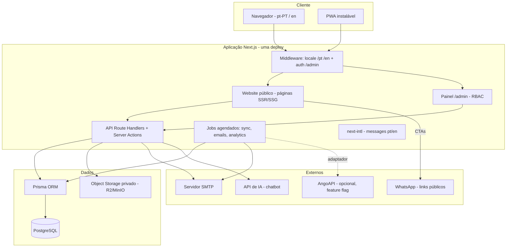

# 04 — Decisões de Arquitectura e Tecnologias

> Data: 2026-10-26 · Estado: **proposta técnica à espera de aprovação humana** (ver doc 23)
> Requisito confirmado pelo cliente (26/10/2026): **website bilingue — Português de Portugal (pt-PT) e Inglês (en)**.

---

## 1. Decisão de topo

**Uma única aplicação Next.js (App Router) que serve o website público, o painel administrativo e a API interna**, com PostgreSQL como base de dados e Prisma como ORM. Sem microserviços. Justificação: equipa/projecto pequeno, custo de operação mínimo, SEO nativo, deploy simples, tudo testável localmente.

### Alternativas avaliadas e rejeitadas

| Opção | Porquê rejeitada |
|---|---|
| Backend separado (NestJS/Fastify) + SPA | Duplicação de infraestrutura, SEO pior, dois deploys, complexidade injustificada para o volume actual |
| Laravel/PHP | O site actual é HTML estático; não há legado PHP. Ecossistema JS permite partilhar tipos entre admin e público |
| WordPress | Não satisfaz RBAC, inscrições, fluxos financeiros, segurança e animação pretendida |
| Next.js + Drizzle | Ambos viáveis; **Prisma escolhido** por maturidade, migrações, DX e documentação — ver §5 |
| Supabase/Firebase como backend | Aproximação "BaaS" útil para Auth+BD rápidas, mas acrescenta dependência externa e custo; com PostgreSQL próprio ganha-se controlo total do backup (relevante em Angola, com conectividade limitada) |

---

## 2. Stack escolhida

| Camada | Tecnologia | Versão | Justificação |
|---|---|---|---|
| Framework | **Next.js (App Router)** | 15.x | SSR/SSG para SEO, API routes integradas, server actions, React Server Components reduzem JS no cliente |
| Linguagem | **TypeScript** | 5.x | Segurança de tipos partilhada entre frontend, API e Prisma |
| UI | **React** | 19.x | Ecossistema actual, compatível com as bibliotecas avaliadas |
| Estilo | **Tailwind CSS** | v4 | Tokens de design centralizados, manutenção rápida, integração nativa |
| Componentes | **Radix UI (primitivos acessíveis) + shadcn/ui** | actual | Base acessível e copiável no projecto (sem lock-in de dependência) |
| Animação | **Motion** (`motion/react`, npm oficial) | actual | Animação React de referência (ex-Framer Motion); tree-shaking, SSR ok |
| Efeitos/arranjos | **Animate UI** e **UI Layouts** (via canais oficiais) | actual | Componentes seleccionados copiados para o projecto — ver §7 |
| Base de dados | **PostgreSQL** | 16+ | Robustez, transacções, JSONB, ftsearch; disponível em qualquer alojamento |
| ORM | **Prisma** | actual | Migrações, typesafe, seed, introspecção |
| Auth | **Auth.js (NextAuth v5)** + credentials + **TOTP (MFA)** | actual | Sessões de servidor, sem dependência externa obrigatória, MFA para admin |
| Ficheiros | **Armazenamento privado S3-compatível** (Cloudflare R2 ou MinIO self-hosted) + URLs assinados | — | Nunca servir documentos privados por URL pública permanente |
| Email | **SMTP transaccional** (Resend ou provedor local via SMTP) | — | Validação por servidor SMTP configurável por env |
| Analytics | **Eventos próprios** (tabela `AnalyticsEvents`) + **Umami** opcional self-hosted | — | Privacidade, sem cookies de terceiros, sem consentimento invasivo |
| i18n | **next-intl** | actual | Suporte App Router, messages por locale, SEO hreflang |
| PWA | **Manifest + Service Worker próprio** (leve) | — | Instalação sem dependência pesada |
| Testes | **Vitest** (unit/integração) + **Playwright** (E2E) | actual | Padrão do ecossistema Next |
| Lint/Format | **Biome** | actual | Rápido, único tool para lint+format (alternativa: ESLint+Prettier) |
| Chatbot | **OpenAI-compatible API via servidor** (chave só em server-side) | — | RAG leve sobre conteúdo da BD, sem vector DB na fase 1 |

---

## 3. Diagrama de arquitectura

## 4. Bilinguismo (PT-PT / EN) — desenho

- **Roteamento por prefixo de locale**: `/pt/...` e `/en/...`, com redirect automático de `/` para `/pt` (locale por omissão) e detecção `Accept-Language` apenas na primeira visita.
- **Biblioteca**: `next-intl` (ficheiros `messages/pt.json`, `messages/en.json` para UI; conteúdo de negócio traduzido na BD).
- **Conteúdo de negócio bilingue**: todas as entidades editáveis (páginas, serviços, cursos, notícias, FAQs) guardam campos traduzíveis (`title_pt`, `title_en`, ou melhor: tabela de traduções 1:1 por locale — ver doc 08). O admin permite editar cada idioma independentemente, com indicador de tradução em falta (a página mostra o locale de fallback enquanto não houver tradução).
- **Fallback**: locale em falta cai para pt-PT; nunca mistura idiomas dentro da mesma página quando a tradução existe.
- **SEO**: `<link rel="alternate" hreflang="pt-PT">` + `hreflang="en">` + `x-default`, sitemap com URLs por locale, metadados traduzidos.
- **Comutador de idioma** no header (e no footer), preservando a página actual (troca o prefixo, mantém o resto do path).
- **Formulários**: labels e mensagens de erro por idioma; notificações por e-mail enviadas no idioma preferido do registado (default pt-PT).
- **Chatbot**: responde em pt-PT ou en conforme o idioma da conversa.
- **Âmbito**: todo o website público. O painel `/admin` fica **apenas em pt-PT** na fase inicial (decisão de simplificação — a confirmar; ver doc 23 Q11).

## 5. Prisma vs Drizzle (porquê Prisma)

| Critério | Prisma | Drizzle | Decisão |
|---|---|---|---|
| Migrações | Maturas, `migrate dev` com diff | Boas, mais manuais | Prisma |
| Tipos gerados | Sim, automáticos | Sim | Empate |
| Curva de aprendizagem | Baixa | Baixa (SQL-like) | Empate |
| Ecossistema/documentação | Muito vasto | Crescente | Prisma |
| Desempenho brute | Muito bom (camada extra) | Ligeiramente melhor | Irrelevante nesta escala |

**Escolha: Prisma** — a camada extra não pesa à escala de uma consultoria e a DX/segurança de migrações compensa.

## 6. Backends, jobs e email

- **API**: Route Handlers REST para operações públicas + Server Actions para o admin. Validação **Zod** em todos os inputs (nunca confiar no cliente).
- **Jobs**: scheduler próprio (tabela de jobs + intervalo via `setInterval` no servidor ou cron do alojamento) para: envio de emails em fila, expiração de vagas, sync AngoAPI (quando ligado), retenção de dados.
- **Email**: fila com tentativas (`NotificationQueue`), templates React Email com identidade CTS, idempotência por `(evento, registo)` para não duplicar mensagens.

## 7. Bibliotecas de design — verificação concluída

Os repositórios `Masukulmiguel/motion`, `Masukulmiguel/animate-ui` e `Masukulmiguel/uilayouts` foram inspeccionados: **são forks pessoais sem alterações dos respectivos upstreams** (`motiondivision/motion`, `imskyleen/animate-ui`, `ui-layouts/uilayouts`). Não devem ser usados como fonte de instalação. Decisão:

- **Motion**: instalar o oficial `npm install motion` (import `motion/react`).
- **Animate UI**: usar o canal oficial (`@animate-ui/cli` / animate-ui.com) quando houver componente que valha a pena; licença *MIT + Commons Clause* (não revender/redistribuir como tal).
- **UI Layouts**: copiar componentes pontuais do registry oficial (ui-layouts.com) para o projecto, com atribuição, evitando dependências pesadas (ex: evitar three.js/R3F salvo justificação).

Regra: **não carregar bibliotecas inteiras quando só interessa um componente**; cada adição de dependência é justificada na doc.

## 8. Ficheiros e segurança transversal

- Uploads: validação por **assinatura binária (magic bytes)**, não por extensão/MIME do browser; limite de tamanho (ex. 10 MB); armazenamento privado; acesso só por URL assinado de curta duração com verificação de sessão+autorização.
- Cookies de sessão: `httpOnly`, `Secure`, `SameSite=Lax`; rotação de sessão após login; revogação global disponível.
- Cabeçalhos de segurança via middleware (CSP, HSTS, X-Frame-Options, etc.); CORS restritivo (mesmo origin por omissão).
- Rate limiting em endpoints públicos (formulários, login, chatbot).
- Segredos apenas em variáveis de ambiente (`.env.example` sem valores reais); nunca no bundle do cliente.

## 9. Custos de operação estimados

| Item | Opção económica | Nota |
|---|---|---|
| Alojamento | VPS (Hetzner/DigitalOcean) ou Vercel | VPS dá controlo total de BD+ficheiros por ~20–40 USD/mês |
| Base de dados | PostgreSQL no mesmo VPS ou Neon/Supabase free tier | Começar no VPS (backup próprio) |
| Ficheiros | Cloudflare R2 (~0 USD de egress) | Alternativa: MinIO no VPS |
| Email | Resend free tier (3k/mês) ou SMTP local | A confirmar (doc 23 Q5) |
| IA chatbot | OpenAI-compatible, pay-per-use | Opcional na fase 1 |

## 10. Decisões pendentes de aprovação humana

1. Provedor de alojamento (VPS vs Vercel) — doc 23 Q3.
2. Provedor de email — Q5.
3. Provedor de pagamentos (quando aplicável) — Q4.
4. Âmbito do bilinguismo no admin (proposta: só público) — Q11.
5. Confirmação final do stack (Prisma vs Drizzle é irreversível após as primeiras migrações).
