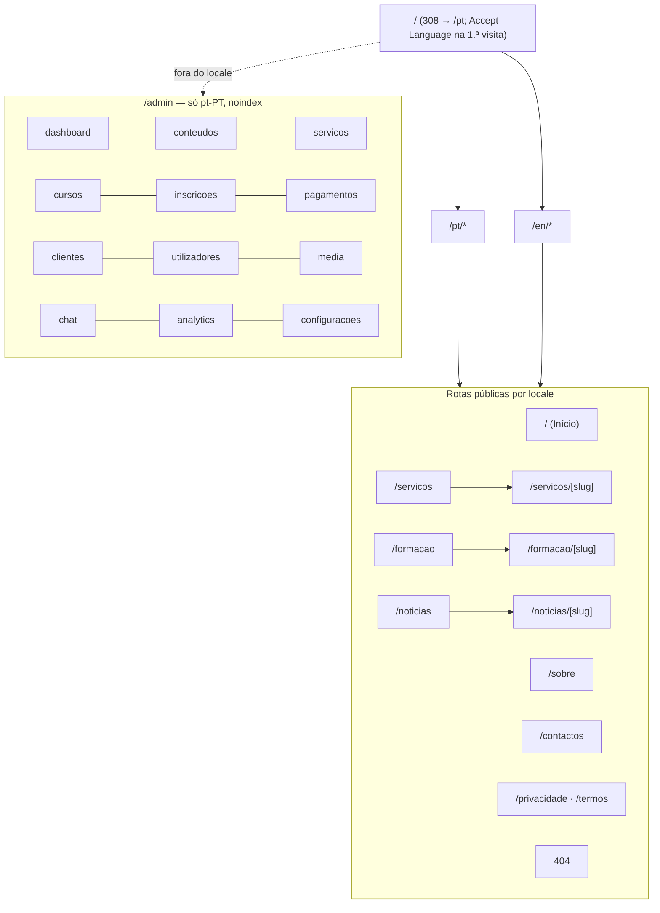

# 06 — Sitemap e Navegação (bilingue pt-PT / EN)

> **Fase 2 — 2026-10-26** · Base: docs 02, 04, 05 · Decisões: D2 (admin só pt-PT), D3 (locale base pt-PT), D6 (bilinguismo obrigatório).
> Regra: nenhum conteúdo novo é publicado sem confirmação real (docs 01/02/23).

## 1. Rotas públicas (prefixo de locale: `/pt/...` e `/en/...`)

| Rota (`[locale]` = `pt` \| `en`) | Página | Notas |
|---|---|---|
| `/` | Redirect | 308 → `/pt/`; na 1.ª visita pode sugerir `/en` por `Accept-Language` |
| `/[locale]` | Início / Home | hero, factos, serviços, formação, institucional, FAQ, CTAs, contactos |
| `/[locale]/sobre` · `/en/about` | Sobre Nós | institucional, missão, CEO (foto+bio), secção `#anpg` (certificação) |
| `/[locale]/servicos` · `/en/services` | Catálogo de serviços | grelha dos serviços publicados (doc 02 §3) |
| `/[locale]/servicos/[slug]` | Página de serviço | descrição, benefícios, processo, FAQ, formulário de solicitação |
| `/[locale]/formacao` · `/en/training` | Catálogo de formação | pesquisa + filtros (categoria/nível/modalidade) |
| `/[locale]/formacao/[slug]` | Página de curso | objectivos, programação, datas, preço, vagas, inscrição |
| `/[locale]/noticias` · `/en/news` | Notícias e Recursos | lista paginada |
| `/[locale]/noticias/[slug]` | Artigo | SEO por locale |
| `/[locale]/contactos` · `/en/contact` | Contactos | mapa, morada, telefones confirmados, formulário |
| `/[locale]/privacidade` · `/en/privacy` | Política de privacidade | **placeholder** — texto a validar juridicamente (Q17) |
| `/[locale]/termos` · `/en/terms` | Termos de uso | **placeholder** — idem (Q17) |
| `/[locale]/pesquisa` (opcional) | Resultados | apenas se pesquisa global for implementada |
| qualquer rota desconhecida | 404 | `not-found.tsx` por locale, com links de recuperação |

> Os **slugs são por locale** (tabela de traduções, doc 08): `sobre`≠`about`, `servicos`≠`services`. Slugs normalizados: minúsculas, sem acentos, hífen.



## 2. Rotas administrativas (`/admin` — **apenas pt-PT**, `noindex`, sem prefixo de locale)

| Rota | Conteúdo (Módulo) |
|---|---|
| `/admin/login` | Autenticação + passo MFA TOTP (M7) |
| `/admin/esqueci-password` | Pedido de recuperação (token por email) |
| `/admin` → `/admin/dashboard` | Indicadores reais + estados vazios honestos (M10) |
| `/admin/conteudos` | CMS: páginas, secções, artigos, FAQs, menus, SEO (M6) |
| `/admin/servicos` | Catálogo de serviços + pedidos? (não: pedidos ficam em clientes) (M3) |
| `/admin/cursos` | Categorias, cursos, **turmas/edições**, formadores (M4) |
| `/admin/inscricoes` | Lista, filtros, transições de estado, documentos, presenças (M4) |
| `/admin/pagamentos` | Validação manual, decisões, recibos, relatórios (M5) |
| `/admin/clientes` | CRM: clientes, pedidos de serviço, funil, histórico (M3) |
| `/admin/utilizadores` | Utilizadores, perfis, permissões, sessões, auditoria (M7/M8) |
| `/admin/media` | Biblioteca multimédia (M6) |
| `/admin/chat` | Conversas, perguntas sem resposta, exportação (M9) |
| `/admin/analytics` | Dashboard de eventos próprios (M10) |
| `/admin/configuracoes` | Definições do site, contactos, integrações/flags (M11/M12) |

Redirects internos: `/admin` sem sessão → `/admin/login?next=…`; rota admin sem permissão → **403** (nunca 404; ver doc 10, testes T1–T10).

## 3. Header (ambos os locales)

```
[logótipo → /pt | /en]  Início · Sobre · Serviços ▾ · Formação ▾ · Notícias · Contactos   [PT | EN]  [Fale Connosco]
```

- **PT**: Início, Sobre, Serviços, Formação, Notícias, Contactos · CTA "Fale Connosco" · CTA secundário "Inscrever-me" (só em `/formacao`).
- **EN**: Home, About, Services, Training, News, Contact · CTA "Get in Touch" · "Enroll Now".
- Dropdown **Serviços**: 6 serviços confirmados (doc 02 §3) + "Ver todos". Dropdown **Formação**: categorias publicadas + "Ver catálogo" (estrutura vazia até Q10).
- **Comutador de idioma** (`PT|EN`): troca apenas o prefixo, preserva path e query; slugs resolvem por locale (doc 04 §4). Sem JS: link `<a hreflang>` directo.
- Estados: header fixo com sombra ao rolar; **menu mobile** (Radix Sheet) com os mesmos itens + comutador + CTA; `aria-current="page"` no item activo; `skip-link` para `#conteudo`.

## 4. Footer (4 colunas + barra inferior)

1. **Empresa**: Sobre, Notícias, Contactos (+ morada/telefones **confirmados** — e-mail só após Q6).
2. **Serviços**: 6 serviços (títulos por locale).
3. **Formação**: catálogo, categorias, "Como inscrever" (âncora do fluxo).
4. **Legal e contacto**: Privacidade, Termos, WhatsApp (link público), botão "Topo".
- Barra inferior: `© 2016–2026 CTS Consultoria Empresarial & Gestão de Negócios · Luanda, Angola` + nota de certificação ANPG (apenas texto confirmado na doc 02).

## 5. Estratégia hreflang / SEO

- Por cada URL pública: `<link rel="alternate" hreflang="pt-PT">`, `hreflang="en"`, `hreflang="x-default"` → variante **pt-PT**, + `<link rel="canonical">` por locale.
- **Reciprocidade obrigatória** (A↔B aponta para A↔B); pares incluídos no `sitemap.xml` único (raiz, com `xhtml:link` alternates).
- `robots.txt` real (criar; hoje 404 — doc 02): permite `/pt/`, `/en/`, bloqueia `/admin/` e `/api/admin/`.
- `/admin` e `/api/*`: `X-Robots-Tag: noindex, nofollow`.
- JSON-LD por locale (Organization, Service, Course, FAQPage) + breadcrumbs (`/pt/formacao/…`).

## 6. Mapa de redirects do site antigo (single-page → multi-página)

| URL antiga | Nova URL (PT) | Nova URL (EN) | Código |
|---|---|---|---|
| `/` | `/pt/` | `/en/` (1.ª visita EN) | 308 (middleware) |
| `/#inicio` | `/pt/` | `/en/` | ver nota † |
| `/#sobre` | `/pt/sobre` | `/en/about` | 301 (†) |
| `/#servicos` | `/pt/servicos` | `/en/services` | 301 (†) |
| `/#anpg` | `/pt/sobre#anpg` | `/en/about#anpg` | 301 (†) |
| `/#contacto` | `/pt/contactos` | `/en/contact` | 301 (†) |
| `/index.html`, `/index.htm` | `/pt/` | — | 301 (middleware) |
| host sem `www` | `https://www.consultoriacts.com` | — | 308 (canonical host) |

† **Os fragmentos nunca chegam ao servidor** (`#…` não é enviado no request). O redirect é **client-side**: no carregamento de `/`, script mínimo lê `location.hash`, verifica a tabela acima (whitelist) e faz `location.replace('/pt/…')` mantendo o fragmento de destino quando existir. URLs fora da whitelist caem no 404 → 200 da home ou 301 para `/pt/`.
- Não existem outras URLs antigas indexadas (doc 02: `robots.txt` e `sitemap.xml` eram 404, single-page) — nenhum redirect adicional é necessário.

## 7. Regras transversais de navegação

- Breadcrumbs em páginas internas (serviço, curso, artigo), com `aria-label`.
- Estados de navegação: `hover`, `focus-visible`, `aria-current`, `aria-expanded` em dropdowns (manter padrões já correctos do site actual — doc 02 §6).
- Alvos de toque ≥ 44×44 px; dropdowns operáveis por teclado (setas/Esc).
- Âncoras internas usam `scroll-margin-top` (header fixo) e `prefers-reduced-motion` (sem smooth-scroll forçado).
