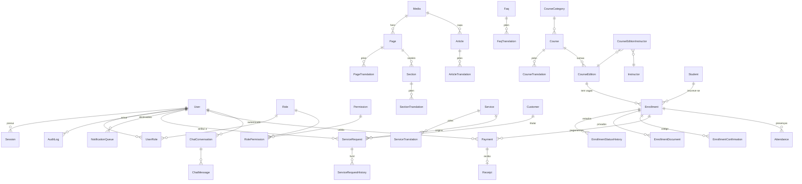

# 08 — Design da Base de Dados (Prisma)

> **Fase 2 — 2026-10-26** · Módulos M1–M12 da doc 05 · PostgreSQL 16 + Prisma (doc 04 §5) · Nomes de campos em **inglês** (código), descrição em **pt-PT**.
> Campos traduzíveis seguem o padrão tabela 1:1 por locale (doc 04 §4) — **nunca** colunas `_pt/_en` na tabela base.

## 1. Convenções

- PK: `id` (`cuid()`) Prisma; referências públicas expostas em URL: colunas separadas `slug`/`number`/`reference` (nunca o `id` interno em páginas).
- FKs: `@relation(... onDelete: Cascade | Restrict)`; `Restrict` em tudo o que tem valor financeiro/legal.
- `@@map("snake_case")` em todas as tabelas; `@@index` nas colunas de filtro frequentes.
- Auditáveis: `createdAt`, `updatedAt` (`@updatedAt`) em todas; `deletedAt` (soft delete) onde a política o exigir (§6).
- Locale: enum `Locale { PT, EN }` — coluna `locale` nas tabelas de tradução.

## 2. Enums principais

| Enum | Valores |
|---|---|
| `Locale` | `PT`, `EN` |
| `UserStatus` | `INVITED`, `ACTIVE`, `SUSPENDED` |
| `PublicationStatus` | `DRAFT`, `PUBLISHED`, `ARCHIVED` |
| `ServiceRequestStatus` (CRM) | `NEW`, `ANALYZING`, `CONTACTED`, `WAITING_CLIENT`, `PROPOSAL_SENT`, `NEGOTIATING`, `CONVERTED`, `REJECTED`, `ARCHIVED` (doc 05 M3) |
| `CourseLevel` | `JUNIOR`, `INTERMEDIATE`, `SENIOR`, `TECHNICAL_PROFESSIONAL`, `GENERAL` (níveis observados nos panfletos — doc 02 Anexo B) |
| `Modality` | `PRESENTIAL`, `HYBRID`, `ONLINE` (apenas `PRESENTIAL` é factual hoje) |
| `EditionStatus` | `PLANNED`, `OPEN`, `CLOSED`, `IN_PROGRESS`, `COMPLETED`, `CANCELLED` |
| `EnrollmentStatus` | `SUBMITTED`, `PROOF_RECEIVED`, `AWAITING_CORRECTION`, `PAYMENT_VALIDATED`, `APPROVED`, `REJECTED`, `WAITING_LIST`, `CANCELLED`, `COMPLETED` |
| `PaymentStatus` | `PENDING`, `APPROVED`, `REJECTED`, `REFUNDED` |
| `PaymentMethod` | `TRANSFER`, `CASH`, `MOBILE_MONEY`, `MULTICAIXA_EXPRESS`, `OTHER` (fase 1: **validação manual**, doc 05 M5/D4) |
| `DocumentKind` | `PROOF_OF_PAYMENT`, `IDENTITY`, `RECEIPT`, `CONFIRMATION`, `OTHER` |
| `NotificationStatus` | `PENDING`, `SENDING`, `SENT`, `FAILED` |
| `ChatRole` | `USER`, `ASSISTANT`, `SYSTEM` |

## 3. Modelos por domínio

### M7 — Utilizadores, RBAC, sessões, auditoria

| Modelo | Campos-chave (PT: descrição) | Restrições/índices |
|---|---|---|
| `User` | `email` (e-mail de login), `passwordHash` (bcrypt/argon2), `name`, `phone`, `locale` (preferido), `status`, `emailVerifiedAt`, `mfaEnabled` (MFA activo), `mfaSecretEnc` (segredo TOTP cifrado, §4), `failedLoginCount`, `lockedUntil` (bloqueio por brute-force), `sessionVersion` (invalidação global de sessões), `deletedAt` | **unique** `lower(email)`; idx `(status)`, `(sessionVersion)` |
| `Role` | `name` (SUPERADMIN, ADMIN, TRAINING_MANAGER, FINANCE, STAFF — perfis doc 05 §2, a confirmar Q9), `description` | **unique** `name` |
| `Permission` | `key` (ex.: `enrollments.approve`), `module`, `description` | **unique** `key` |
| `RolePermission` | `roleId`, `permissionId` (perfil × acção) | PK composta `(roleId, permissionId)` |
| `UserRole` | `userId`, `roleId` (papel atribuído) | PK composta `(userId, roleId)` |
| `Session` | `token` (hash do cookie), `userId`, `ipHash` (IP com hash, sem guardar IP puro), `userAgent`, `createdAt`, `expiresAt`, `revokedAt` | **unique** `token`; idx `(userId)`, `(expiresAt)` |
| `PasswordResetToken` | `userId`, `tokenHash`, `expiresAt` (1 h), `usedAt` | idx `(tokenHash)`; single-use |
| `MfaRecoveryCode` | `userId`, `codeHash`, `usedAt` | idx `(userId)` |
| `AuditLog` | `actorUserId` (null = sistema), `action`, `entity`, `entityId`, `before`/`after` (JSONB, só campos não sensíveis), `ipHash`, `requestId`, `createdAt` | idx `(entity, entityId)`, `(actorUserId, createdAt)`, `(createdAt)`; **nunca** soft delete |

### M1/M6 — CMS, páginas, artigos, FAQs, media, definições

| Modelo | Campos-chave | Restrições/índices |
|---|---|---|
| `Page` | `status` (publicação), `publishedAt`, `showInNav`, `sortOrder`, `deletedAt` | idx `(status, publishedAt)` |
| `PageTranslation` | `pageId`, `locale`, `slug`, `title`, `heroMediaId`, `seoTitle`, `seoDescription`, `ogImageId` | **unique** `(pageId, locale)`; **unique** `(locale, slug)` |
| `Section` | `pageId`, `type` (hero|grid|faq|cta|richtext|gallery), `settings` (JSONB), `sortOrder`, `deletedAt` | idx `(pageId, sortOrder)` |
| `SectionTranslation` | `sectionId`, `locale`, `content` (JSONB de blocos) | **unique** `(sectionId, locale)` |
| `Media` | `storageKey` (chave no bucket privado), `mimeType`, `sizeBytes`, `width`, `height`, `checksumSha256`, `originalName`, `alt`, `uploadedById`, `deletedAt` | **unique** `checksumSha256` (dedupe); idx `(deletedAt)` |
| `Article` | `status`, `publishedAt`, `coverMediaId`, `authorUserId`, `deletedAt` | idx `(status, publishedAt)` |
| `ArticleTranslation` | `articleId`, `locale`, `slug`, `title`, `excerpt`, `content`, `seoTitle`, `seoDescription` | **unique** `(articleId, locale)`, `(locale, slug)` |
| `Faq` | `status`, `category`, `sortOrder`, `deletedAt` | idx `(status, sortOrder)` |
| `FaqTranslation` | `faqId`, `locale`, `question`, `answer` (alimenta JSON-LD FAQPage e o chatbot M9) | **unique** `(faqId, locale)` |
| `Setting` | `key`, `value` (JSONB), `updatedBy` | PK/unique `key`; valores só pt-PT |

### M3 — Serviços + CRM

| Modelo | Campos-chave | Restrições/índices |
|---|---|---|
| `Service` | `status`, `icon`, `featured`, `sortOrder`, `deletedAt` | idx `(status, sortOrder)` |
| `ServiceTranslation` | `serviceId`, `locale`, `slug`, `title`, `summary`, `content` (JSONB), `benefits` (JSONB), `audience`, `seo…` | **unique** `(serviceId, locale)`, `(locale, slug)` |
| `Customer` | `type` (PERSON/COMPANY), `name`, `email`, `phone`, `nif`, `notes`, `ownerUserId`, `deletedAt` | idx `(lower(name))`, `(ownerUserId)` |
| `ServiceRequest` | `reference` (`SR-AAAA-0000`), `customerId`, `serviceId?`, `source` (CONTACT_FORM/SERVICE_FORM/ADMIN), `subject`, `message`, `locale`, `status` (funil CRM), `assignedUserId`, `nextFollowUpAt`, `deletedAt` | **unique** `reference`; idx `(status)`, `(assignedUserId)`, `(createdAt)` |
| `ServiceRequestHistory` | `requestId`, `fromStatus`, `toStatus`, `actorUserId`, `note`, `createdAt` (auditoria do funil) | idx `(requestId, createdAt)` |
| `ServiceRequestDocument` | `requestId`, `mediaId`, `visibility` (INTERNAL/PUBLIC) | unique `(requestId, mediaId)` |

### M4/M5/M8 — Formação, inscrições, pagamentos, funcionários

| Modelo | Campos-chave | Restrições/índices |
|---|---|---|
| `CourseCategory` + `CourseCategoryTranslation` | `status`, `sortOrder` / `locale`, `name`, `description`, `slug` | unique `(locale, slug)` |
| `Course` | `categoryId`, `status`, `level`, `modality`, `requiresInefop` (certificação INEFOP — doc 02), `defaultPriceAOA?`, `durationText?`, `deletedAt` | idx `(status, level, modality)` |
| `CourseTranslation` | `courseId`, `locale`, `slug`, `title`, `summary`, `objectives`, `program`, `requirements`, `location`, `seo…` | **unique** `(courseId, locale)`, `(locale, slug)` |
| `CourseEdition` (turma) | `courseId`, `code` (`CT-2026-01`), `startDate`, `endDate`, `schedule`, `location`, `seatsLimit` (vagas), `seatsHeld` (contador de vagas ocupadas, §5), `priceAOA?`, `status`, `deletedAt` | **unique** `code`; idx `(courseId, status)`, `(startDate)` |
| `Instructor` | `name`, `bio`, `photoMediaId?`, `published` (nada é publicado sem confirmação) | idx `(published)` |
| `CourseEditionInstructor` | `editionId`, `instructorId` | PK composta |
| `Student` (formando) | `userId?` (conta opcional; obrigatória para auto-consulta), `firstName`, `lastName`, `email`, `phone`, `idNumber` (BI), `birthDate`, `educationLevel`, `deletedAt` | idx `lower(email)`; *(PII mínimo, doc 05 §4)* |
| `Enrollment` | `number` (`INS-AAAA-000000`), `editionId`, `studentId`, `status`, `seatHeld` (ocupa vaga?), `locale`, `notesInternal`, `submittedAt`, `deletedAt` | **unique** `number`; unique parcial (§4); idx `(editionId, status)`, `(status, createdAt)`, `(number)` |
| `EnrollmentStatusHistory` | `enrollmentId`, `fromStatus`, `toStatus`, `actorUserId?` (null = sistema), `note`, `createdAt` (estados distintos: prova ≠ pagamento ≠ aprovação ≠ recibo — doc 05 M4) | idx `(enrollmentId, createdAt)` |
| `EnrollmentDocument` (privado) | `enrollmentId`, `kind`, `mediaId`, `originalName`, `scanStatus`, `validatedById?`, `deletedAt` | idx `(enrollmentId)`; **sem qualquer URL pública** (doc 09 §6) |
| `EnrollmentConfirmation` | `enrollmentId`, `code` (verificação/QR), `issuedAt`, `pdfMediaId`, `revokedAt` | **unique** `enrollmentId`, **unique** `code` |
| `Payment` | `reference`, `enrollmentId?`, `amountAOA` (numeric(12,2)), `method`, `paidAt`, `proofDocumentId?`, `status`, `decidedByUserId?`, `decidedAt`, `decisionReason`, `deletedAt` | **unique** `reference`; idx `(enrollmentId)`, `(status, paidAt)` |
| `Receipt` | `number`, `paymentId`, `issuedAt`, `pdfMediaId`, `issuedByUserId` | **unique** `number`, **unique** `paymentId` |
| `Attendance` | `enrollmentId`, `editionId`, `date`, `present`, `markedByUserId` | **unique** `(enrollmentId, date)`; idx `(editionId, date)` |
| `Employee` (M8) | `userId?`, `name`, `department`, `jobTitle`, `phone`, `status`, `hiredAt`, `deletedAt` | registo básico, **sem** dados sensíveis (doc 05 M8) |

### M9–M12 — Chat, analytics, notificações, integrações

| Modelo | Campos-chave | Restrições/índices |
|---|---|---|
| `ChatConversation` | `sessionHash` ou `userId?`, `locale`, `status` (OPEN/CLOSED), `startedAt`, `lastMessageAt`, `retentionUntil`, `deletedAt` | idx `(lastMessageAt)`, `(retentionUntil)` |
| `ChatMessage` | `conversationId`, `role`, `content`, `createdAt` (sem dados pessoais de terceiros — doc 05 M9) | idx `(conversationId, createdAt)` |
| `AnalyticsEvent` | `name`, `path`, `locale`, `referrerHost` (só host), `device`, `sessionHash`, `userId?`, `props` (JSONB minimizado, **sem IP completo**) | idx `(createdAt)`, `(name)` |
| `NotificationQueue` | `channel`, `template`, `locale`, `toEmail`, `payload` (JSONB), `idempotencyKey`, `status`, `attempts`, `nextAttemptAt`, `sentAt`, `lastError` | **unique** `idempotencyKey` (anti-duplicados); idx `(status, nextAttemptAt)` |
| `IntegrationSyncLog` (M12) | `integration` (ANGOAPI), `direction`, `entity`, `entityId`, `status`, `requestSummary`, `responseSummary` (JSONB mascarado), `error`, `createdAt` | flag `ANGOAPI_ENABLED=false` → nenhum registo é criado (doc 03 §7) |

## 4. Restrições únicas transversais

1. **Slug por locale**: `unique(locale, slug)` em cada `*Translation` — mesmo slug pode existir em PT e EN, nunca 2× no mesmo locale.
2. **Número de inscrição**: `unique(number)`, formato `INS-AAAA-NNNNNN`, sequência por ano (`pg_get_serial_sequence`/tabela de contadores dentro da transacção).
3. **Inscrição duplicada** (índice único **parcial**, criado por SQL na migração — o Prisma não os modela): `unique(editionId, studentId) WHERE status NOT IN ('CANCELLED','REJECTED')`. Cancelar/rejeitar liberta a vaga e permite nova inscrição; re-submissão do mesmo aluno reutiliza a linha.
4. Integridade financeira: `Receipt.paymentId` unique; `Payment` com `status` só alterável por transição auditada; `onDelete: Restrict` de `Enrollment`/`Payment`.

## 5. Controlo de vagas transaccional

**Estratégia: contador optimista na `CourseEdition`, sempre na mesma transacção do INSERT da inscrição:**

```sql
-- dentro de prisma.$transaction([...], { isolationLevel: 'ReadCommitted' })
UPDATE course_editions
   SET seats_held = seats_held + 1
 WHERE id = $editionId
   AND status = 'OPEN'
   AND seats_held < seats_limit
 RETURNING id;          -- 0 linhas => turma cheia => WAITING_LIST, sem contador alterado
INSERT INTO enrollments (...) VALUES (...);   -- mesma transacção
```

- `seatsHeld` é alterado **apenas** aqui e nas transições `→ CANCELLED/REJECTED` (decremento condicional `WHERE seats_held > 0`).
- Reconciliação diária: job compara `seatsHeld` com `COUNT(enrollments WHERE seatHeld = true)` e alerta em `AuditLog` se divergir.
- Teste de concorrência obrigatório (20 submissões simultâneas ≤ limite) — critério Fase 7 (doc 21).

## 6. Política soft delete vs hard delete

| Política | Entidades | Regra |
|---|---|---|
| **Soft delete** (`deletedAt`) | Page, Section, Article, Faq, Service, Course, CourseEdition, Media, Customer, ServiceRequest, Student, Employee, User, Enrollment, Payment | nunca desaparecem do histórico; listas filtram `deletedAt: null`; "eliminar" = arquivar; restauro 30 dias |
| **Sem delete** (append-only) | AuditLog, EnrollmentStatusHistory, ServiceRequestHistory, Receipt, Attendance, EnrollmentConfirmation | imutáveis; correcções criam novas linhas |
| **Hard delete permitido** | ChatMessage/ChatConversation (após retenção), AnalyticsEvent (após retenção), payloads da NotificationQueue > 90 dias, uploads temporários órfãos, tokens expirados | automático por job, registado em `AuditLog` (contagem) |
| **Anonimização** | dados pessoais de Student/Enrollment/Payment após expirar a retenção | substituir PII por valores anónimos, manter métricas |

> Nenhum registo financeiro/legal é apagado por acção de UI (apenas estado `CANCELLED`/`ARCHIVED`).

## 7. Proposta de retenção (a validar — Q17/Q18 e doc 11)

| Dados | Retenção proposta |
|---|---|
| Sessões expiradas / tokens de reset | limpeza imediata (24 h reset; sessão idle 30 dias) |
| Comprovativos e documentos de inscrição | 5 anos após fim da edição (ou prazo legal confirmado) |
| Inscrições, pagamentos, recibos | 5 anos (mínimo fiscal a confirmar juridicamente) |
| Conversas de chat | 12 meses (`retentionUntil`) + aviso na UI |
| Eventos de analytics | 13 meses |
| NotificationQueue (payloads) | 90 dias após `SENT` |
| AuditLogs | 3 anos (mínimo 2) |
| Media não utilizada | delete físico após 90 dias de `deletedAt` (após verificação de uso) |

## 8. Diagrama ER (condensado — colunas omitidas; traduções 1:1 por locale)


