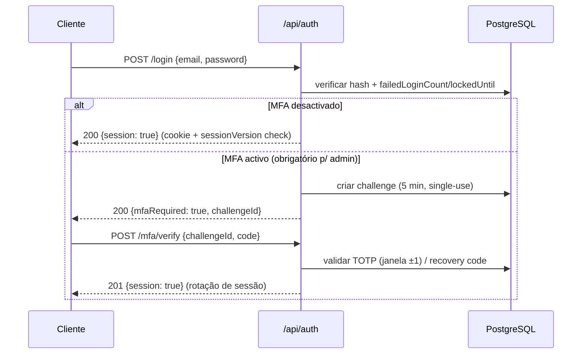

# 09 — Especificação de API

> **Fase 2 — 2026-10-26** · Route Handlers REST (`/api/…`) + Server Actions no admin (doc 04 §6) · validação **Zod** em todos os inputs, sempre server-side.
> Sessão: cookie Auth.js (`httpOnly`, `Secure`, `SameSite=Lax`), rotação no login (doc 04 §8).

## 1. Convenções de envelope e erros

```json
// Sucesso (200/201): { "data": <object|array>, "meta": { … } }
// Erro (4xx/5xx):
{ "error": { "code": "VALIDATION_ERROR", "message": "Mensagem legível (pt-PT).",
             "details": [{ "field": "email", "issue": "invalid_email" }],
             "requestId": "req_01J…" } }
```

| Código | Quando |
|---|---|
| `200` OK · `201` Created · `204` No Content | sucesso |
| `400` `VALIDATION_ERROR` | Zod falhou (nunca expor stacktrace) |
| `401` `UNAUTHENTICATED` | sem sessão/expirada |
| `403` `FORBIDDEN` · `404` `NOT_FOUND` | sem permissão / recurso inexistente ou não pertencente ao utilizador |
| `409` `CONFLICT` | slug/número duplicado, vagas esgotadas, turma fechada |
| `413`/`415` `PAYLOAD_TOO_LARGE`/`UNSUPPORTED_MEDIA_TYPE` | upload > 10 MB / tipo não permitido |
| `422` `BUSINESS_RULE_VIOLATION` | transição de estado inválida, etc. |
| `429` `RATE_LIMITED` | limite excedido (header `Retry-After`) |
| `500` `INTERNAL` | erro genérico + `requestId` (detalhes só em logs) |

**Paginação**: `?page=1&pageSize=25` (máx. 100) → `meta: { page, pageSize, total, totalPages }`. **Ordenação**: `?sort=-createdAt` (prefixo `-` = desc). **Filtros comuns**: `q`, `status`, `locale`, `from`, `to`.

**CSRF**: todas as mutações (`POST/PATCH/PUT/DELETE`) exigem (a) cookie `SameSite=Lax`, (b) header custom `X-Requested-With: XMLHttpRequest` **ou** token double-submit em formulários, (c) verificação de `Origin`/`Sec-Fetch-Site: same-origin`. Falha → `403 CSRF_FAILED`. Server Actions do admin usam o mesmo check + auth do Next.js.

**Rate limiting** (doc 10 §5): por classe de endpoint; storage em memória/Redis com chave `classe+ipHash`.

## 2. Dados públicos (GET — cache `revalidate`, idioma via `?locale=pt|en`)

| Endpoint | Descrição |
|---|---|
| `GET /api/public/courses?category=&level=&modality=&q=&page=` | catálogo paginado (só `PUBLISHED` + edições `OPEN`) |
| `GET /api/public/courses/{slug}` | curso por slug **no locale** + traduções de metadados |
| `GET /api/public/courses/{slug}/editions` | turmas futuras com vagas/preço (ou "a definir") |
| `GET /api/public/services` · `GET /api/public/services/{slug}` | serviços publicados |
| `GET /api/public/articles?category=&page=` · `…/articles/{slug}` | notícias |
| `GET /api/public/faqs?scope=home|service:{slug}|course:{slug}` | FAQs para UI e JSON-LD |
| `GET /api/public/site` | definições públicas: contactos confirmados, menus, redes sociais (só existentes) |
| `GET /api/public/pages/{slug}` | páginas CMS (inclui legais) |

Nenhum endpoint público retorna dados pessoais, vagas internas, notas ou documentos.

## 3. Formulários públicos (POST — honeypot + rate limit + Zod)

| Endpoint | Payload | Notas |
|---|---|---|
| `POST /api/public/contact` | `name, email?, phone?, subject, message, locale, website? (honeypot)` | persiste em `ServiceRequest(source=CONTACT_FORM)` + email admin (M11) |
| `POST /api/public/service-requests` | `{ serviceSlug, name, email, phone, company?, message, locale, website? }` | cria Customer se inexistente; `status=NEW` |
| `POST /api/public/enrollments` | `multipart/form-data`: `editionId, firstName, lastName, email, phone, idNumber?, locale?, notes?, proof? (ficheiro)` | cria Student+Enrollment (`SUBMITTED`), **comprovativo opcional na mesma submissão**; devolve `number` |
| `POST /api/public/enrollments/{number}/proof` | `multipart` com `file` | só com token de correção (link de 72 h do email) ou sessão de formando |
| `POST /api/public/newsletter` (opcional, fase 1: não implementar) | — | fora de âmbito até decisão |

Resposta padrão: `201 { data: { reference|number, status } }` + email automático. **Uploads** seguem a política da doc 10 §7 (magic bytes, ≤10 MB, bucket privado).

## 4. Autenticação (`/api/auth/*`)



| Endpoint | Descrição |
|---|---|
| `POST /api/auth/login` | `{email,password}` → `200 {mfaRequired, challengeId}` ou sessão; `401` genérico (nunca distinguir utilizador inexistente); `423/429` após 5 falhas (lockout progressivo) |
| `POST /api/auth/mfa/verify` | `{challengeId, code}` TOTP ou recovery |
| `POST /api/auth/logout` | revoga sessão actual (`204`) |
| `GET /api/auth/session` | sessão actual ou `401` |
| `POST /api/auth/password/forgot` | `{email}` → **sempre `202`** (sem enumeração), token 1 h, single-use |
| `POST /api/auth/password/reset` | `{token, password}` → revoga **todas** as sessões (`sessionVersion++`) |
| `POST /api/auth/mfa/enroll` | autenticado → `{secret, otpauthUrl, QR}` (segredo cifrado em BD) |
| `POST /api/auth/mfa/confirm` | `{code}` → activa MFA + gera recovery codes (mostrados 1×) |
| `POST /api/auth/mfa/disable` | `{password, code}` → obrigatório re-autenticar |

## 5. Auto-consulta do formando (`/api/student/*` — sessão + verificação de dono)

| Endpoint | Descrição |
|---|---|
| `GET /api/student/me` | perfil, `locale`, estado MFA |
| `GET /api/student/enrollments` | **apenas** inscrições do próprio (filtro `userId/studentId` da sessão) |
| `GET /api/student/enrollments/{id}` | detalhe + histórico de estados resumido; `404` se não for do próprio (não `403`, para não revelar existência) |
| `GET /api/student/enrollments/{id}/documents` | metadados dos documentos (nunca binário directo) |
| `POST /api/student/enrollments/{id}/documents` | novo comprovativo em estado `AWAITING_CORRECTION` |
| `GET /api/student/documents/{id}/url` | → `{ url, expiresAt }` **URL assinado** (§7) |
| `GET /api/student/confirmations/{id}/url` | PDF de confirmação de inscrição (assinado) |

Conta: criada automaticamente na inscrição com verificação de e-mail obrigatória antes do acesso (M4/M7).

## 6. Admin (`/api/admin/*` — sessão + **permissão verificada no servidor**)

Padrão por módulo: `GET /api/admin/{recurso}?page&pageSize&q&status&sort` (lista) · `GET /{recurso}/{id}` · `POST /{recurso}` · `PATCH /{recurso}/{id}` · `DELETE /{recurso}/{id}` (soft delete, exige confirmação server-side).

| Recurso | Permissões mínimas (chave) | Acções especiais |
|---|---|---|
| `dashboard` | `dashboard.read` | métricas reais + estados vazios honestos |
| `pages`, `sections`, `articles`, `faqs`, `menus`, `seo` | `content.read/write/publish` | `POST /{r}/{id}/publish`, `/unpublish`, `/preview` (link pré-visualização 24 h, assinado) |
| `services` | `services.read/write` | idem publish |
| `course-categories`, `courses`, `editions`, `instructors` | `courses.read/write` | `POST /editions/{id}/open|close` |
| `enrollments` | `enrollments.read`, `.transition`, `.approve` | `POST /{id}/transition {toStatus, note}` (histórico+audit); `POST /{id}/confirmation` (emite código/PDF); `POST /{id}/attendance {date, present}`; `GET /verify?number=` (pesquisa/QR) |
| `payments` | `payments.read`, `payments.decide` | `POST /{id}/decision {decision: APPROVED\|REJECTED, reason}` (**humano, sempre** — D4); `POST /{id}/receipt` |
| `customers`, `service-requests` | `crm.read/write` | `POST /{id}/transition` (funil), `/assign`, `/follow-up` |
| `documents` (provas) | `documents.read` | `POST /{id}/signed-url` (5 min, auditado) |
| `users`, `roles` | `users.read/write`, `roles.manage` | `POST /{id}/roles`, `POST /{id}/revoke-sessions`, `POST /{id}/reset-mfa`, `POST /users` (convida, estado `INVITED`) |
| `media` | `media.read/write` | `POST /upload` (multipart), `GET /{id}/signed-url`, `POST /{id}/replace`, `DELETE /{id}` |
| `chat` | `chat.read` | `GET /conversations?…`, `POST /conversations/{id}/export` (CSV, auditado) |
| `analytics` | `analytics.read` | agregados (não eventos individuais com PII) |
| `settings` | `settings.manage` | inclui feature flags (`ANGOAPI_ENABLED=false`) |
| `audit-logs` | `audit.read` | **somente leitura**, sem exportação de `before/after` sensível |

## 7. Chat (M9)

| Endpoint | Descrição |
|---|---|
| `POST /api/chat` | `{conversationId?, message, locale}` → `{reply, conversationId, sources?}`; ferramentas limitadas a leitura de conteúdo **publicado**; rate limit por sessão; sem dados pessoais |
| `GET /api/chat/conversations/{id}` | histórico do próprio (anónimo por `sessionHash`) ou admin |
| `DELETE /api/chat/conversations/{id}` | apaga a conversa do utilizador |

## 8. URLs assinados para ficheiros privados (semântica)

1. Só após **sessão válida + verificação de dono/permissão** (nunca por conhecer o `mediaId`).
2. Formato: `GET /api/files/{mediaId}?exp={unix}&sig={hmac}` com **HMAC-SHA256** (`FILE_SIGNING_SECRET`), TTL **5 min** (máx. 15 min), recurso único, não listável.
3. Resposta do ficheiro: `Content-Type` real, `X-Content-Type-Options: nosniff`, `Content-Disposition: attachment` (PDFs/imagens), `Cache-Control: private, no-store`.
4. Invalidação: revogar sessão (`sessionVersion`), `media.deletedAt` ou rotação de segredo → `403 URL_EXPIRED/URL_INVALID`.
5. Toda a emissão é registada em `AuditLog` (quem, qual ficheiro, quando).
