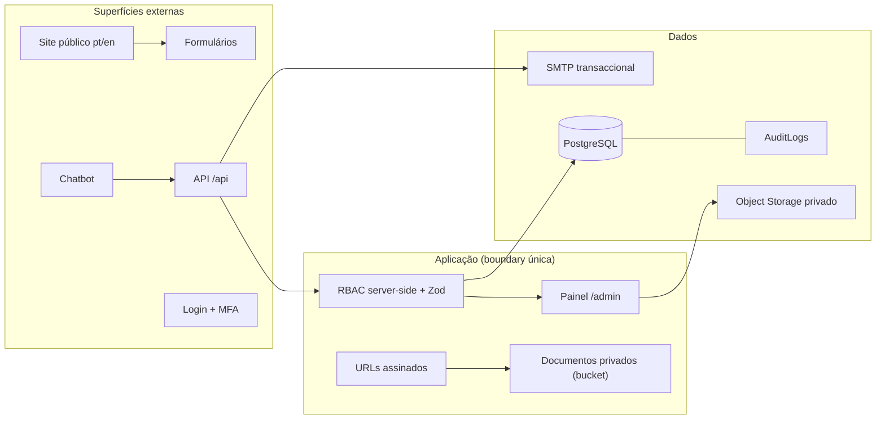

# 10 — Modelo de Ameaças e Controlos de Segurança

> **Fase 2 — 2026-10-26** · Abordagem **STRIDE-lite** por superfície · baseline OWASP ASVS L2 + requisitos da doc 05 §4 e doc 04 §8.
> Risco: **A**lto / **M**édio / **B**ixo. Valores reais de teste ficam na doc 24 (Fase 10) — nada é declarado sem evidência.



## 1. Autenticação

| Ameaça (STRIDE) | Risco | Controlo |
|---|---|---|
| Força-bruta / credential stuffing no login | A | rate limit por IP **e** por conta; lockout progressivo (`failedLoginCount`, `lockedUntil`); erro `401` genérico (sem enumeração de utilizadores) |
| Roubo de sessão (cookie) | A | cookie `httpOnly`+`Secure`+`SameSite=Lax`, rotação de sessão no login, expiração idle 30 dias, revogação global via `sessionVersion` |
| Omissão/roubo de MFA TOTP | A | **MFA TOTP obrigatório para administradores** (doc 05 M7); segredo cifrado (AES-GCM, `APP_ENCRYPTION_KEY`); recovery codes single-use; challenge de login expira em 5 min |
| Registo de conta livre na admin | A | admin **nunca** por auto-registo: convite (`INVITED`) por superadmin; seed inicial por fluxo seguro (doc 21, Fase 3) |
| Reset de password abusado / enumeração | M | token hasheado, 1 h, single-use; resposta `202` sempre igual; após reset `sessionVersion++` (todas as sessões morrem) |
| Fraude CSRF em mutações | M | `SameSite=Lax` + verificação de `Origin`/`Sec-Fetch-Site` + header custom (doc 09 §1) |

## 2. RBAC e autorização

| Ameaça | Risco | Controlo |
|---|---|---|
| Escalada de privilégio (acções sem permissão) | A | permissão verificada **sempre no servidor**, por chave (`enrollments.approve`, `payments.decide`, …); esconder botões não conta (doc 05 M7) |
| IDOR (aceder a recurso de terceiro pelo `id`) | A | dono do recurso verificado em cada query (`studentId/userId` da sessão); `404` em vez de `403` na auto-consulta (não revela existência) |
| Mass-assignment (enviar `role`/`status` no body) | M | Zod com *allow-list* de campos por endpoint; campos de estado/role só em endpoints dedicados e auditados |
| Perfis mal configurados | M | papéis como **dados** (tabela `Role`), matriz perfil×acção documentada e revista; mínimo privilegiamento; superadmin = 1 conta |
| Sessão revogada a continuar a funcionar | M | verificação de `revokedAt`/`sessionVersion` em **cada** request admin; `POST /users/{id}/revoke-sessions` |

**Os 10 testes de autorização obrigatórios** (breafing §20; correm no Fase 10 — doc 21):

| # | Cenário | Esperado |
|---|---|---|
| T1 | Sem sessão → `GET /api/admin/enrollments` | `401` |
| T2 | Sessão sem permissão (STAFF) → `POST /api/admin/payments/{id}/decision` | `403` + `AuditLog` |
| T3 | Formando A → `GET /api/student/enrollments/{id}` de B | `404` |
| T4 | Formando A → `GET /api/student/documents/{id}/url` de B | `404` |
| T5 | Financeiro tenta publicar conteúdo (`POST /api/admin/pages/{id}/publish`) | `403` |
| T6 | Admin tenta elevar o próprio role via `PATCH /api/admin/users/{id}` | `400/403` (campo ignorado/denegado) |
| T7 | URL assinado expirado ou de outro `mediaId` | `403 URL_EXPIRED/URL_INVALID` |
| T8 | Sessão revogada por superadmin → request seguinte | `401` |
| T9 | Chatbot: pedido de dados pessoais/inscrições de terceiros | recusa + encaminhamento, **sem** consulta à BD além de conteúdo publicado |
| T10 | Submissão directa a `/api/admin/*` ignorando a UI (mesmo payload) | igualmente `401/403` (a UI nunca é a barreira) |

## 3. Uploads e ficheiros (estratégia de validação)

| Ameaça | Risco | Controlo |
|---|---|---|
| Ficheiro malicioso / disfarçado (polyglot, XSS armazenado) | A | **magic bytes** reais (`%PDF`, `FFD8FF`, `89504E47`, `RIFF….WEBP`) via `file-type`, nunca extensão/MIME do browser; allow-list (PDF/JPG/PNG/WEBP); resto → `415` |
| Excesso de tamanho / DoS | M | limite **10 MB** (413), contagem de bytes no stream, nº de ficheiros por pedido limitado |
| Execução/serve de conteúdo activo | A | bucket **privado**, sem ACL pública, chave gerada aleatória (sem path do utilizador), `X-Content-Type-Options: nosniff`, `Content-Disposition: attachment`, sem HTML servido do domínio de ficheiros |
| Acesso directo a comprovativos | A | só **URL assinado** de 5 min com HMAC + sessão/propriedade (doc 09 §8); toda a emissão auditada |
| Nome de ficheiro / path traversal | M | nome original só como metadado; path gerado pelo servidor; normalização + remoção de `/`, `..`, controlo |
| Ficheiro órfão/indisponível | B | Multipart grava directo no bucket; `mediaId` confirmado só após sucesso; limpeza de órfãos por job |
| Malware em comprovativos | M (fase 1: aceite) | opcional ClamAV em staging/produção; mitigação: nunca executar/abrir no servidor, download forçado |

## 4. Formulários públicos

| Ameaça | Risco | Controlo |
|---|---|---|
| Spam/bot submissions | M | honeypot invisível + tempo mínimo de preenchimento + rate limit por classe (§5); CAPTCHA **só** se necessário (doc 05 M3) |
| Injecção SQL/NoSQL | A | Prisma parametrizado + Zod; **nunca** `raw` sem `Prisma.sql` parametrizado |
| XSS armazenado/reflexivo | A | React escape por defeito; `dangerouslySetInnerHTML` só com sanitização allow-list (se usado); CSP (§6) |
| Validação só no cliente | A | toda a regra repetida no servidor (mesmo schema Zod) |
| Enumeração/over-collect | B | campos opcionais mínimos; finalidade documentada por campo (doc 05 M4) |

## 5. Rate limiting (política)

| Classe | Limite (por IP/sessão, salvo indicação) | Em cima |
|---|---|---|
| Leitura pública (`GET /api/public/*`) | 60 req/min | 5/min adicional → 429 + `Retry-After` |
| Contacto / pedido de serviço | 5/h e 20/dia por IP | — |
| Submissão de inscrição | 3/h e 10/dia por IP | por conta: 20/dia |
| Login | 5 tentativas/15 min por IP **e** 10 por conta | lockout exponencial até 30 min |
| Forgot/reset password | 3/h por IP · 3/24h por conta | — |
| MFA verify | 5/5 min por challenge | challenge expira em 5 min |
| Chat (`POST /api/chat`) | 20/min e 100/dia por sessão | sanitização de input adicional |
| Geração de URLs assinados | 30/min autenticado | auditada |
| Admin autenticado | 300 req/min | — |

Implementação: contador por `classe + hash(IP)` (janela deslizante), resposta `429` + header `Retry-After`; limites de segurança configuráveis via `Setting`, nunca abrandados silenciosamente.

## 6. CSP e cabeçalhos de segurança

```
Content-Security-Policy:
  default-src 'self';
  script-src 'self' 'nonce-{random}' 'wasm-unsafe-eval';
  style-src 'self' 'unsafe-inline';            # Tailwind/estilos inline do Next
  img-src 'self' data: blob: https://www.google.com https://*.gstatic.com;
  font-src 'self';                              # fontes self-hosted (next/font)
  connect-src 'self';                           # chat/IA passa pelo servidor (chave nunca no browser)
  frame-src https://www.google.com;             # só o embed do mapa (doc 02 §1)
  object-src 'none'; base-uri 'self'; form-action 'self';
  frame-ancestors 'none'; upgrade-insecure-requests;
  report-uri /api/security/csp-report
```
Complementos no middleware: `Strict-Transport-Security (max-age=31536000; includeSubDomains)`, `X-Content-Type-Options: nosniff`, `X-Frame-Options: DENY`, `Referrer-Policy: strict-origin-when-cross-origin`, `Permissions-Policy: geolocation=(), camera=(), microphone=()`, `Cross-Origin-Opener-Policy: same-origin`. Em produção CSP inicialmente `Content-Security-Policy-Report-Only` por 1 semana → enforce. Sem analítica de terceiros (doc 04 §2) → `connect-src` nunca abre para domínios externos.

## 7. Chatbot (M9)

| Ameaça | Risco | Controlo |
|---|---|---|
| Prompt injection a extrair dados/instruções | A | instrução de sistema fixa + input sanitizado/comprimento limitado; ferramentas do servidor **somente leitura sobre conteúdo publicado**; sem query livre à BD |
| Fuga de dados pessoais de terceiros | A | teste negativo obrigatório (T9); sem acesso a `Student/Enrollment/Payment`; registo de conversa para revisão |
| Chave de IA no cliente / abuso de quota | A | chave só em server-side; rate limit §5; custos monitorizados; **flag** — se a IA não estiver aprovada (Q7), o endpoint serve FAQ estático |
| Comportamento não determinístico | M | fonte: FAQs/serviços/cursos publicados; resposta padrão "não sei → contacte" |

## 8. Email, analytics, admin, dependências, deploy, backups

| Superfície | Ameaça | Risco | Controlo |
|---|---|---|---|
| Email | Fila reinjectada/duplicada ou phishing interno | M | `idempotencyKey` única por (evento, registo); templates React Email com identidade CTS; SPF/DKIM do provedor; nunca incluir documentos/senhas no corpo |
| Email | Registo de reset reutilizado | M | token single-use + 1 h + `sessionVersion++` |
| Analytics | Fingerprinting/PII em eventos | M | sem IP completo (apenas `sessionHash`/truncado), sem cookies de terceiros, minimização de `props` (doc 05 M10) |
| Admin | XSS armazenado em CMS → admin comprometido | A | sanitização + CSP + MFA obrigatório + curta sessão idle (8 h) para acções financeiras |
| Admin | Eliminação/acção destructiva indevida | M | confirmação server-side, soft delete, `AuditLog` imutável, transições com nota |
| Dependências | Supply-chain / CVEs | A | `npm audit` + Trivy + Gitleaks + Semgrep no CI (doc 21 Fase 3/10); fewer deps (doc 04 §7); lockfile commitado |
| Deploy | Segredos no repositório | A | segredos **só** em env vars (§9); `gitleaks` bloqueia merge; bundle do cliente verificado sem segredos |
| Deploy | AngoAPI/terceiros com credenciais expostas | A | flag `ANGOAPI_ENABLED=false`; nunca importar padrões inseguros do AngoAPI (doc 03 §6: webhook sem verificação, `.env` público) |
| Deploy | Superadmin com credencial fixa | A | criação por fluxo seguro one-shot (prompt/env de 1.º arranque), nunca seed com password constante (doc 21 Fase 3) |
| Backups | Exposição de comprovativos/PII nos backups | A | backup cifrado em repouso, acesso só a superadmin, restauro **testado** (doc 05 §4) |
| Backups | Perda de dados | M | diário full + WAL; retenção 30 dias; documentação de rollback (doc 21 Fase 11) |

## 9. Gestão de segredos

1. Segredos apenas em variáveis de ambiente de produção (`.env.example` sem valores; nunca em logs, erros ou `NEXT_PUBLIC_*`).
2. Inventário: `DATABASE_URL`, `AUTH_SECRET`, `APP_ENCRYPTION_KEY` (cifra MFA/PII), `FILE_SIGNING_SECRET`, `SMTP_*`, `OPENAI_API_KEY` (opcional), `ANGOAPI_*` (inactivo).
3. Rodízio: semestral e após qualquer suspeita; rotação de `FILE_SIGNING_SECRET` invalida URLs emitidos (TTL ≤15 min torna-a indolor); rotação de `AUTH_SECRET` derruba sessões (executar em janela de manutenção).
4. Cada ambiente (dev/staging/prod) tem segredos próprios; menor privilégio na BD (`SELECT/INSERT/UPDATE/DELETE`, sem `DROP` para a app).
5. CI: `gitleaks` + scan de histórico; alerta se um segredo aparecer em commits.
